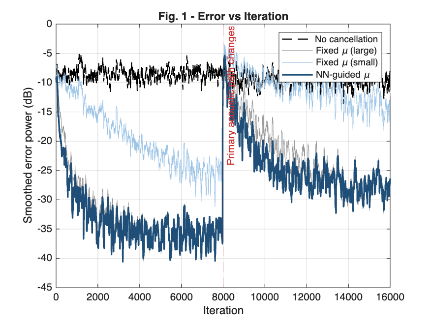
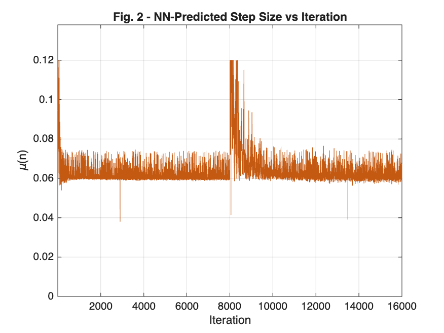
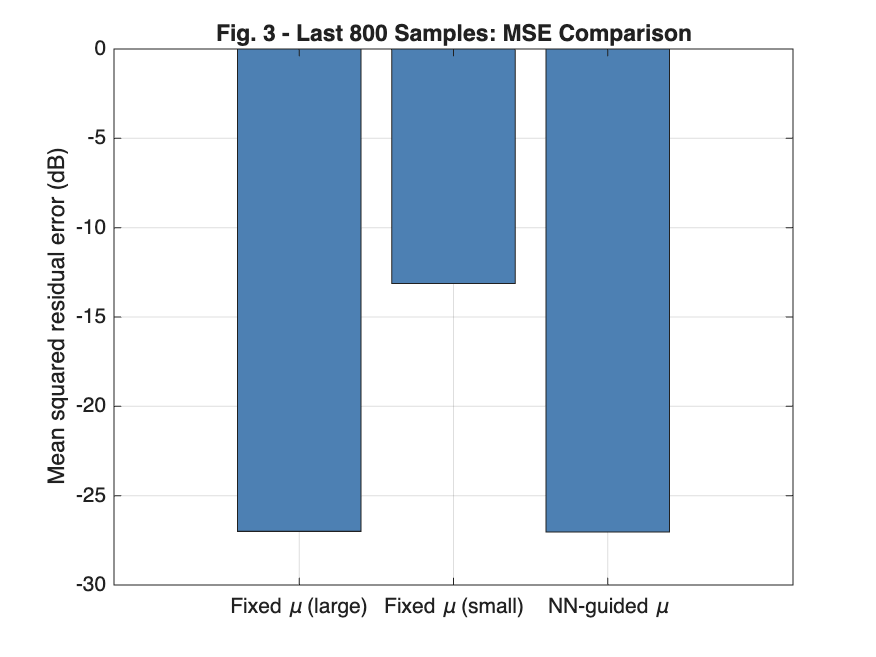
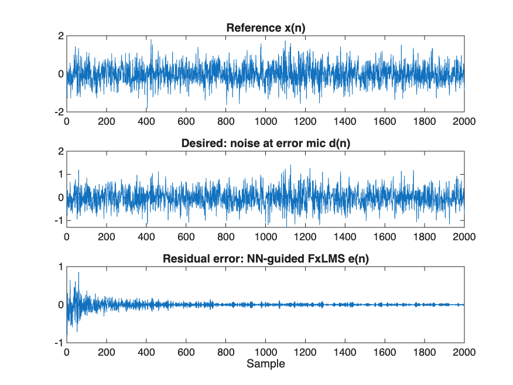

# Neural-Network-Guided Variable-Step-Size FxLMS for Active Noise Control

**DSP Laboratory Project | MATLAB | 28 October 2026**

## Overview
This project implements active noise control (ANC) using filtered-x least mean squares (FxLMS), comparing a fixed adaptation step size with a neural-network-guided variable step size. A synthetic primary acoustic path changes halfway through each simulation to measure transient recovery, alongside final steady-state performance.

**Scope:** MATLAB simulation only. The secondary path is known exactly in the simulator; hardware measurements and secondary-path identification are not included.

## Highlights and measured results
Results below are copied from the MATLAB command-window output shared after running `main` and `benchmark_fair`; they have **not been independently reproduced in this repository packaging environment**.

| Metric | Result |
|---|---:|
| Deterministic FxLMS tests | 7 / 7 PASS |
| NN integration tests | 3 / 3 PASS |
| Fixed step selected on validation | 0.0500 |
| Held-out tail NR, tuned fixed | 17.966 dB |
| Held-out tail NR, NN guided | 18.024 dB |
| Tail NR difference | +0.058 dB |
| Average after-change NR difference (NN − fixed) | **+2.389 dB** |
| After-change seed wins | **6 / 8** |

**Interpretation:** The NN-guided controller improved average post-change noise reduction in this eight-run benchmark. Final tail performance was essentially tied (+0.058 dB). These results do not establish universal or statistically significant superiority.

### Single-run results (`main` output)
| Metric | Fixed small μ | Fixed large μ | NN-guided μ |
|---|---:|---:|---:|
| Full run NR (dB) | 3.31 | 10.76 | **13.15** |
| Before change NR (dB) | 7.63 | 16.82 | **18.72** |
| After change NR (dB) | 0.97 | 8.09 | **10.56** |
| Last 800 NR (dB) | 4.30 | 18.18 | **18.21** |

The neural network predicts offline-oracle step-size labels with weak fit (training R² = 0.021; chronological hold-out R² = −0.010; high-spread hold-out R² = −0.055). That limitation must be distinguished from the observed controller-level cancellation metric.

## Algorithm
The reference microphone records `x(n)`; the primary path generates undesired signal `d(n)`. Control output `y(n)` reaches the error sensor via secondary path `S(z)`; the residual is `e(n) = d(n) - S(z) * y(n)`. FxLMS filters the reference with an estimate of the secondary path, `x_f(n)`, and adapts FIR coefficients as

```text
w(n+1) = w(n) + μ(n) e(n) x_f_vector(n)
```

The fixed baseline holds `μ` constant. The NN controller selects bounded `μ(n)` from causal error/reference features. Oracle label generation may use future data **offline**, but deployment must remain causal.

## Prerequisites
- MATLAB (recent release; MATLAB Online supported)
- Deep Learning Toolbox (`feedforwardnet`, `train`)

## Quick start
Open the project folder as MATLAB's current folder, then run:

```matlab
verify_code          % 10 automated checks
main                 % train NN, test controllers, save plots and metrics
benchmark_fair       % validation tuning + eight held-out simulations (slow)
```

For a faster preliminary evaluation:

```matlab
benchmark_quick
```

The quick benchmark is less statistically reliable than `benchmark_fair`. Do not treat them as interchangeable evidence.

## File guide
| File | Function |
|---|---|
| `main.m` | Orchestrates synthetic signal generation, oracle labels, NN training, baseline and NN runs, reporting |
| `generate_signals.m` | Simulated paths, reference/noise, switch halfway through |
| `run_fxlms.m` | Fixed-step FxLMS baseline |
| `run_fxlms_nn.m` | NN-guided adaptive FxLMS, step-size trace |
| `generate_oracle_dataset.m` | Offline labels from candidate step sizes |
| `train_mu_network.m` | Train the step-size regressor |
| `plot_results.m` | Save four original figures and MSE chart |
| `verify_code.m` | Seven deterministic FxLMS checks plus three NN integration checks |
| `benchmark_fair.m` | Validation-selected fixed baseline versus 8 independent held-out runs |
| `benchmark_quick.m` | Lightweight optional benchmark |
| `mu_sweep.m` | Fixed-gain diagnostics |
| `figures/` | Captured MATLAB plots supplied by the project author |
| `project_report.pdf` | Submission report; cover QR finalized after publication |

## Included figures





## Reproducibility and limitations
- Test and validation samples must remain separated. Do not tune a fixed baseline on final test runs.
- This benchmark uses a single simulated acoustic scenario and eight seeds; results might change under other paths and noise distributions.
- Tail NR improvement of 0.058 dB is too small to characterize as a decisive steady-state gain.
- The NN oracle-label R² is weak; model generalization and overhead deserve further study.
- MATLAB scripts are included as submitted; the PDF is a report of results reported by MATLAB, not a hardware validation.

## Add the GitHub QR code to the report
After this code is uploaded to a **public GitHub repository**, run the bundled utility with the exact repository URL:

```bash
python add_repo_qr.py https://github.com/YOUR_USERNAME/YOUR_REPOSITORY
```

It generates `github_qr.png` and `project_report_with_qr.pdf` with a scannable QR code on the report cover. Requires Python packages `pymupdf`, `qrcode[pil]`, and `reportlab` (only for this report utility—not for MATLAB simulation).

## Academic integrity
Interpret performance claims as averages for the specified simulation, not guarantees of superiority. The source code and outcome metrics should be retained with submitted records.
